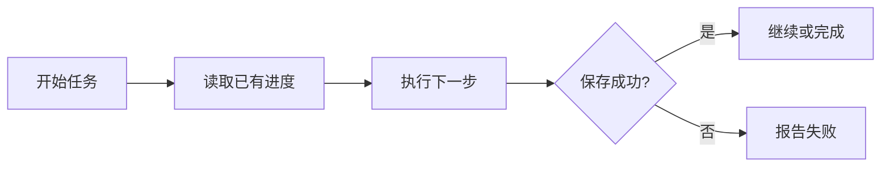

# my-plan 写作规范：准确、易懂、图文配合

适用于 `create` 生成的 Plan、`execute` 生成的 Build Log。这里规定**表达方式**；技术方案仍以实际仓库和用户要求为准。

## 1. 写给谁看

假设读者懂常规编程，但**不熟悉这个子模块**。目标是：

- **30 秒**看懂：要解决什么、改完有什么变化。
- **3 分钟**看懂：数据/请求如何流动，主要改动在哪里。
- **深入阅读**能实施/审计：接口、文件、边界、测试、风险齐全。

优先级：准确性不能牺牲；通过**分层展开**降低阅读负担，而不是删除重要设计细节。

## 2. 具体写法

**推荐：**
- 先写**结果/目的**，再写**原因/做法**。
- 一句话尽量只表达一个判断；多步过程用编号。
- 用“读取 / 校验 / 保存 / 返回 / 重试”这类动词表达行为。
- 核心术语第一次出现时，用括号或冒号做一次短解释。
- 可读性优先的顺序：**具体场景 → 简图 → 实现细节 → 边界和异常**。
- 每个技术小节尽量回答：**输入是什么 → 做了什么 → 输出/失败时怎样**。
- 使用具体且有证据的代码路径、函数、数据对象、命令。

**避免：**
- “抽象层能力建设”“核心链路闭环”“语义一致性保障”等没有具体行为的说法。
- 一句塞进 4–5 个术语：“依赖状态编排与持久化语义增强任务生命周期一致性”。
- 未解释就密集出现 `CAS / WAL / FSM / DTO / DAG` 等缩写。
- 只说“提高稳定性 / 性能 / 可维护性”，没有说明**具体可观察的变化**。
- 大段文字复述图中的所有箭头；大表格里塞完整段落。
- 没有代码证据就宣称“当前架构是 X”“已存在模块 Y”。

### 改写示例（示意，不代表当前仓库事实）

**太浓缩：**
> 引入检查点机制解耦执行生命周期和状态持久化，实现故障场景下的可恢复性。

**更清楚：**
> 现在任务执行中断后，只能从头开始。改动后，任务会在关键步骤完成时保存进度（检查点）。服务重启后读取这份进度，从上次完成的步骤继续。
>
> 实现上，需要在任务执行器写入进度，并在任务启动时判断是否已有可恢复的记录。

**太空泛：**
> 优化异常处理，提升系统鲁棒性。

**更清楚：**
> 当存储写入失败时，任务返回明确的失败状态，不把未保存的进度标记为成功。测试需覆盖“写入失败 → 任务失败 → 不产生完成记录”。

## 3. 简图怎么选

**原则：一张图解释一个问题。** 图用来帮助读者建立直观理解，**不是**追求图多。

| 想解释的问题 | 推荐形式 |
| --- | --- |
| 改动前后有什么不同 | 2 个小型 ASCII 流程（首选） |
| 一次请求经过哪些模块 | Mermaid `flowchart LR` 或 ASCII |
| 成功/失败如何分支 | 带标签的流程图 |
| 有哪些状态和状态跳转 | Mermaid `stateDiagram-v2`（确实存在状态机时） |
| 谁依次调用谁 | Mermaid `sequenceDiagram`（跨组件交互复杂时） |

### A. Before / After（必要时使用，示意）

```text
改动前：请求 → 执行任务 → 中途出错 → 整个任务失败
改动后：请求 → 执行任务 → 保存进度
                             ↓
         进程重启 → 读取进度 → 从断点继续
```

图下紧接一句：**变化在于：任务中断后不必从头重跑。**

### B. 带失败分支的流程（示意）



图下紧接一句：**关键边界：进度未保存成功时，不应报告任务已完成。**

### C. 模块关系（示意）

```text
API 层 → 任务服务 → 状态存储
             ↓
           执行器
```

图下紧接一句：**任务服务负责协调，执行器处理具体任务，状态存储只保存进度。**

**绘图检查：**
1. 不要画不存在的文件、组件或数据流；未来拟新增的节点标明“新增/拟新增”。
2. 一张图通常 3–8 个节点，优先保持在 10 个以内；必要时拆图。
3. 箭头方向要准确；影响验收的异常分支要画出来。
4. Mermaid 节点采用短中文标签；仅在确实需要分支/时序时使用 Mermaid。
5. 图下 1–3 句话讲清读图重点；避免把长篇说明塞进节点。
6. 小任务可只用一张 ASCII 图，不为了凑数量增加无用图。

## 4. Plan 与 Build Log 的措辞差异

**Plan 用将来/拟议语气：**
- “计划在 `...` 新增 `saveCheckpoint()`，用于保存进度。”
- “验收时运行 `go test ./...`，要求相关测试通过。”
- “`...` 的实际路径待确认；执行前先搜索 `...`。”

**Build Log 用事实/完成语气：**
- “已在 `...` 新增 `saveCheckpoint()`；保存失败会返回错误。”
- “已运行 `go test ./...`：PASS，退出码 0。”
- “未运行集成测试：本地没有所需数据库，因此结果未知。”

不能把预期效果写成已验证的效果。做了代码修改 ≠ 功能通过测试。

## 5. 输出前自检

- [ ] 开头 5–8 行无需了解具体代码，也能明白目的和预期/实际结果。
- [ ] 前后差异直观；非平凡流程有一张真正有用的简图。
- [ ] 图、文字、文件清单和异常分支一致。
- [ ] 不堆术语；每个有歧义的重要术语第一次出现时已解释。
- [ ] 文件路径和命令能在仓库中找到，或明确标“待确认/未运行”。
- [ ] 重要实现边界、回滚、验收没有因追求简洁而漏掉。
- [ ] Build Log 只记实做改动，测试结果有证据，没有复述假设。
